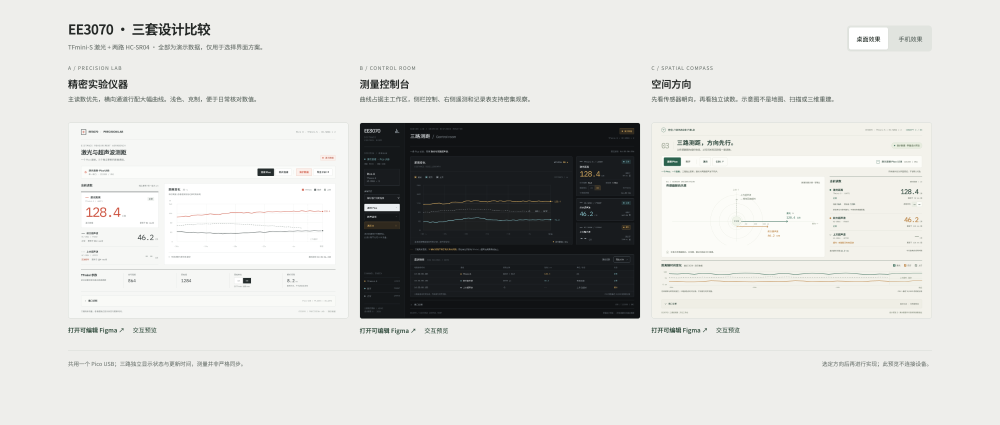

# 统一测距前端 · 三套设计方案

同一页面组织 TFmini-S 激光、前方 HC-SR04、上方 HC-SR04，围绕一个 Pico USB 连接展示三个独立通道。



[手机布局对比](previews/comparison-mobile.png) · [检查记录](previews/QA.md) · [可编辑 Figma 文件](https://www.figma.com/design/gRakiEjVhFartJGVOWtVsU)

| 方案 | 信息组织 | HTML 源码 | Figma 桌面 |
| --- | --- | --- | --- |
| A · Precision Lab 精密仪器 | 浅色仪器界面，突出主读数和宽趋势图 | [打开](opendesign/mockups/a-precision-lab/index.html) | [打开](https://www.figma.com/design/gRakiEjVhFartJGVOWtVsU?node-id=4-101) |
| B · Control Room 测量控制台 | 深色会话侧栏、示波图、遥测和原始记录 | [打开](opendesign/mockups/b-control-room/index.html) | [打开](https://www.figma.com/design/gRakiEjVhFartJGVOWtVsU?node-id=4-1162) |
| C · Spatial Compass 方向可视化 | 传感器朝向示意和各通道读数清单 | [打开](opendesign/mockups/c-spatial-compass/index.html) | [打开](https://www.figma.com/design/gRakiEjVhFartJGVOWtVsU?node-id=4-650) |

## 本地查看

在仓库根目录运行：

```sh
python3 -m http.server 8289 --bind 127.0.0.1 --directory design-explorations/opendesign-20261027
```

浏览器打开 http://127.0.0.1:8289/opendesign/，或 http://127.0.0.1:8289/opendesign/mockups/comparison/ 并排查看。字体及许可随源码提供。

预览 viewer 来自 [OpenDesign](https://github.com/manalkaff/opendesign)，保留其 [MIT 许可](opendesign/LICENSE)；各字体许可位于对应 assets 或 fonts 目录。

## 设计预览与实际采集

本目录是可交互的设计演示，所有读数和记录均为模拟数据，控件不访问 USB 或串口。实际三路采集程序、启动方式和硬件验证记录见 [distance_mac_viewer](../../distance_mac_viewer/README.md)。

三套方案均有桌面和手机布局，包含通道状态、更新时间、TFmini 强度和原始值、cm/mm 原始单位设置、30 秒趋势、通道显隐、连接操作、CSV 预览和串口诊断。TFmini 解析间隔不等于传感器真实采样间隔；三个通道按各自时间记录。C 的图形只表示传感器朝向。

- [opendesign/mockups](opendesign/mockups/)：三套独立 HTML、说明、字体与许可。
- [figma](figma/README.md)：可编辑画板链接、几何数据和构建源码。
- [previews](previews/QA.md)：HTML 对比、最终 Figma 画面与检查记录。
